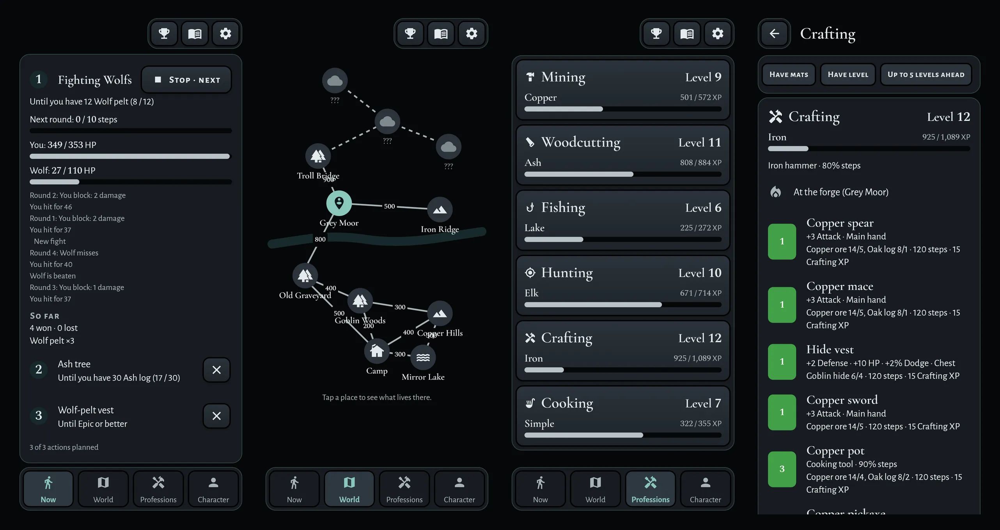
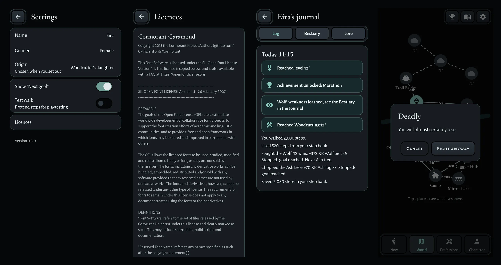
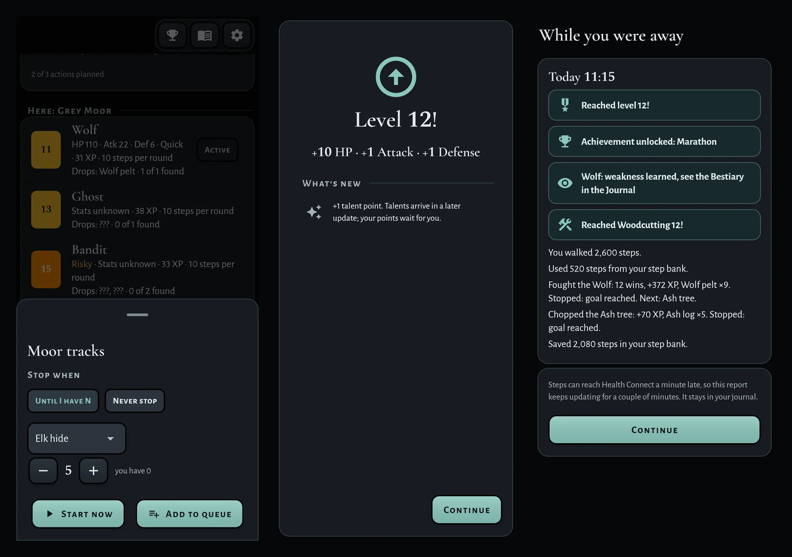
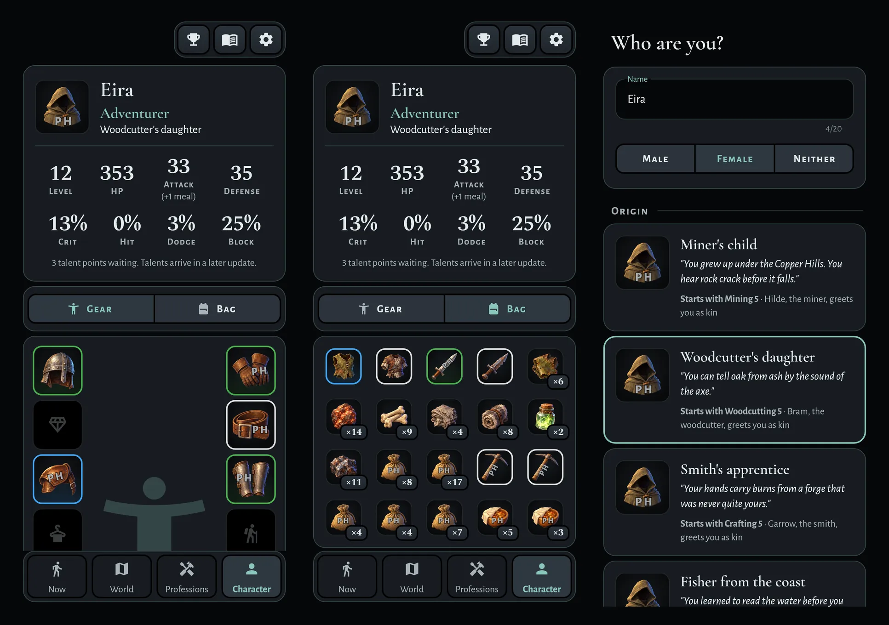
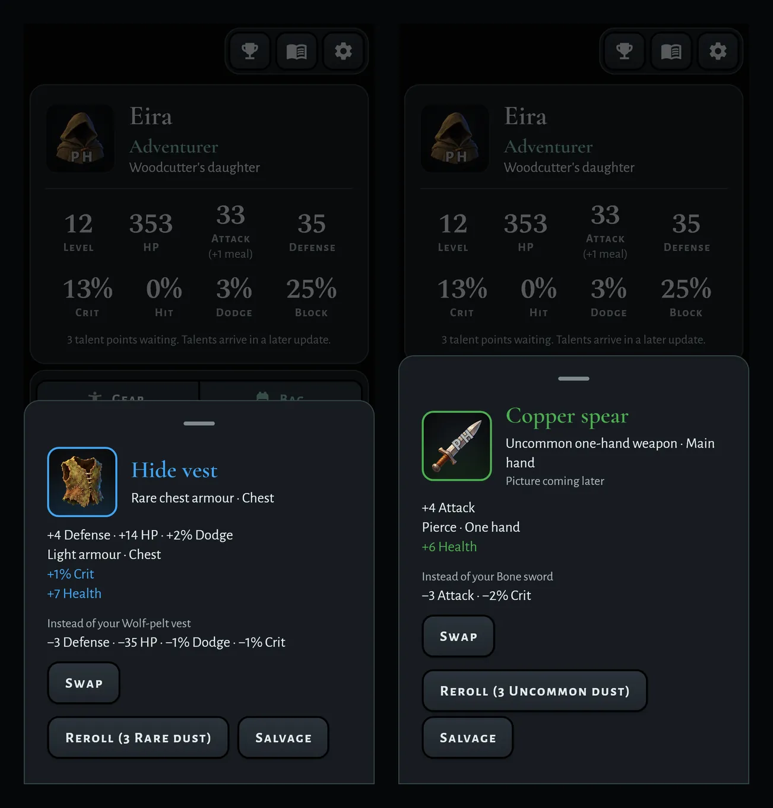
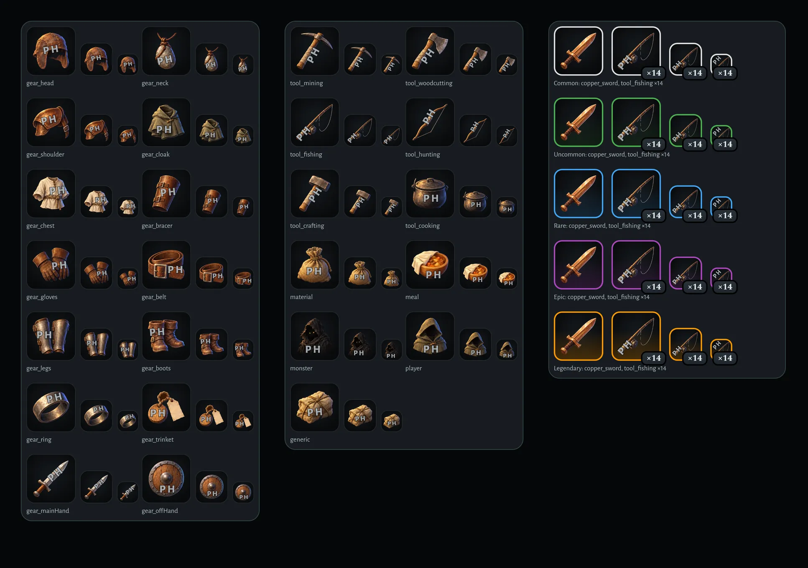
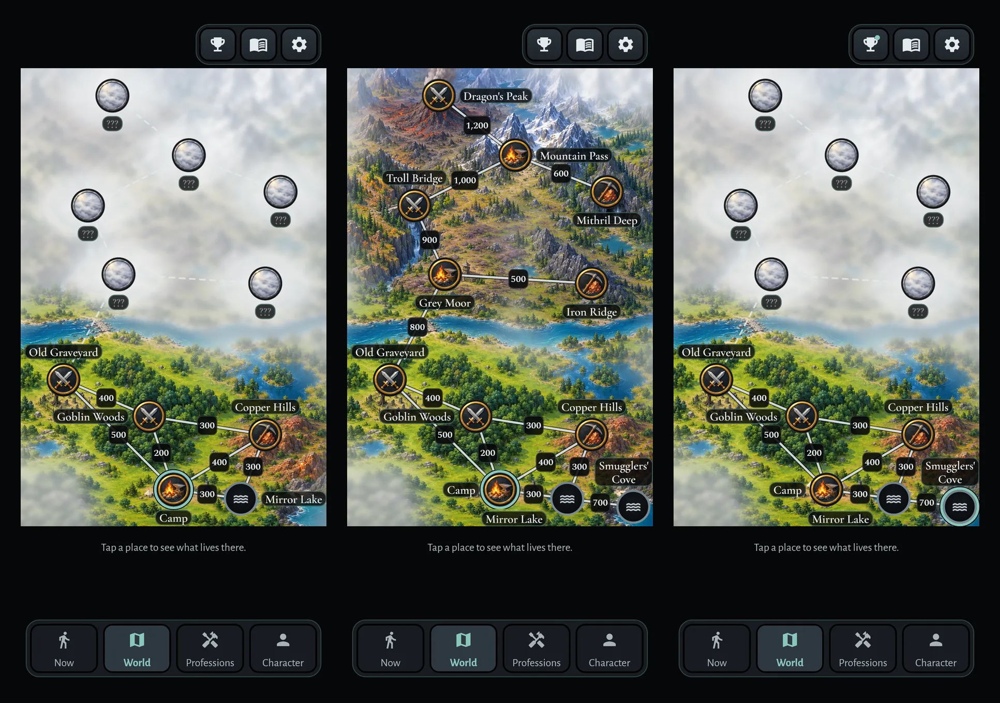
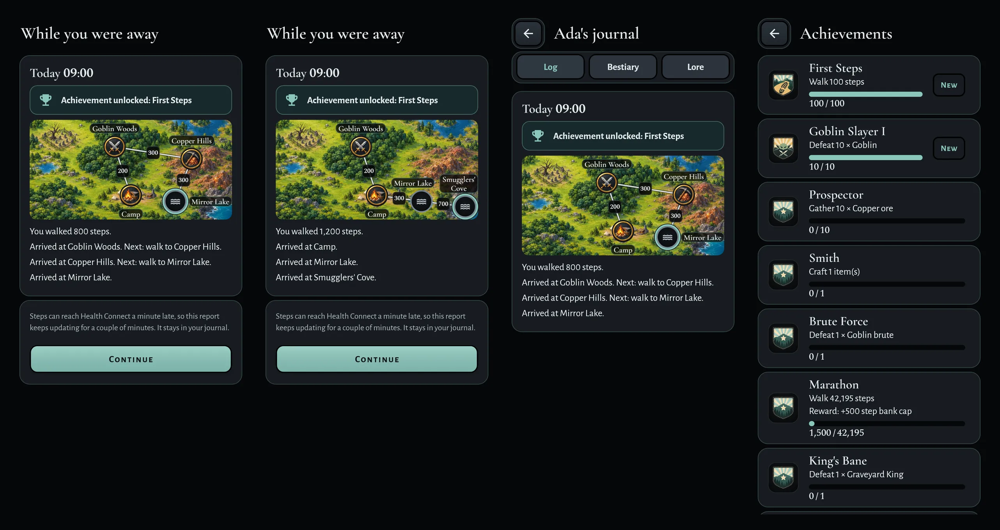

# Quiet Teal: the screens as built (plan 0017)

This file shows the screens of plan 0017 as the app draws them. Each milestone adds its section. A reviewer can
compare the renders with the target:
- the spec: `specs/0014-quiet-teal.md`;
- the design images: `0014-quiet-teal-*.webp` and `0017-m*-*.webp` in this folder.

If a render and the spec differ, the spec wins.

## How we made the renders
- A widget test draws each screen at 360 x 780 dp, with a pixel ratio of 3 (1080 x 2340 px).
- The test loads the four fonts of the app, the Material icons and the images of the app.
- The test draws real shadows and no DEBUG banner.
- Most of the game state comes from steps through the fake step source. Where steps cannot make a state, for example
  a revealed Smugglers' Cove, the test sets it.
- In M1 and M2, the player is Eira (female, Woodcutter's daughter), level 12, in Grey Moor.
- The test is not in the repository. A phone can show small differences, for example in the status bar.
- Each board puts its renders side by side, as a WebP file 1,280 px high.

## M1: theme, controls and fonts

Now with an action and two more in the queue, World, Professions, and the Crafting page.

Settings, Licences, the Journal and the "Deadly" dialog.

The action sheet, the level-up card and the away report.

Notes:
- On the World map of M1, some names and step counts overlap, for example "Troll Bridge" and "900". M3 places
  them so that nothing overlaps (spec 0014 §2.3).

## M2: images, sockets and placeholders

The Character tab with Gear and with Bag, and "Who are you?".

The card of a gear item with its image (Hide vest, Rare), and of one with a placeholder (Copper spear, Uncommon).

Each placeholder with its PH mark, and the ring and the wash of each quality.

Notes:
- M3 changes the Character header. The origin is body text in Alegreya Sans (spec 0014 §2.2). If the rank and the
  origin do not fit on one line, the origin goes on its own line, without the "·". These renders show that change.
- 148 of 241 things show a placeholder for now: most items, all tools and meals, and all portraits.

## M3: World, route and Achievements

The World map: a new game with fog; each place explored, with the player at Camp; and the player at Smugglers' Cove.

The away report of a walk over two days, Camp → Goblin Woods → Copper Hills → Mirror Lake, with the route map
between the banner and the lines; a walk from Goblin Woods to Smugglers' Cove; the journal entry of the first walk;
and Achievements with their pictures.

Notes:
- Each marker sits on its map point. Only Smugglers' Cove moves, about 5 dp left and 1 dp up, so that the marker and
  the ring stay on the map.
- The names and the step counts do not move when the player moves.
- On a phone narrower than 360 dp, the map keeps the layout of 360 dp and draws smaller. The route map does the same
  in its card, so its names are about 12 dp high on a phone of 360 dp.
- With Smugglers' Cove revealed, the only free spot for the name "Mirror Lake" is under Camp. It keeps the rules, but
  it can read as the name of Camp.
- The map shows no painted fog, unlike the design phones: spec 0014 §4.2 keeps the fog as today.
- These renders come before M4, so the banners and the earned achievements keep their earlier look.

## Seen in the renders, outside plan 0017
- Now shows "Fighting Wolfs". The label adds "s" to the name of the monster (`app/lib/ui/labels.dart`).
- The item card names the slot twice: "Rare chest armour · Chest" and "Light armour · Chest" (spec 0009 §8.2).
