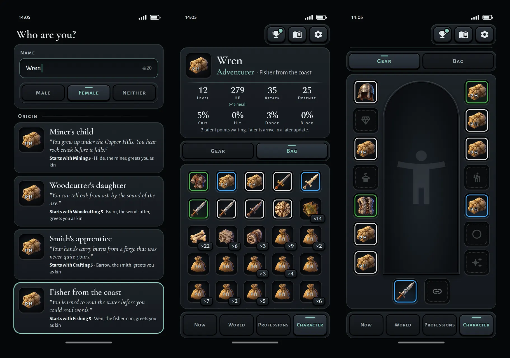
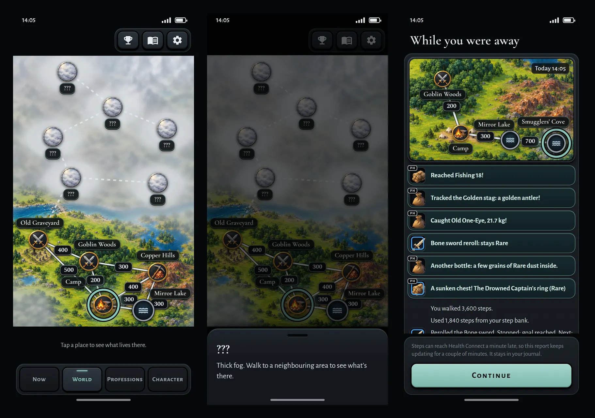
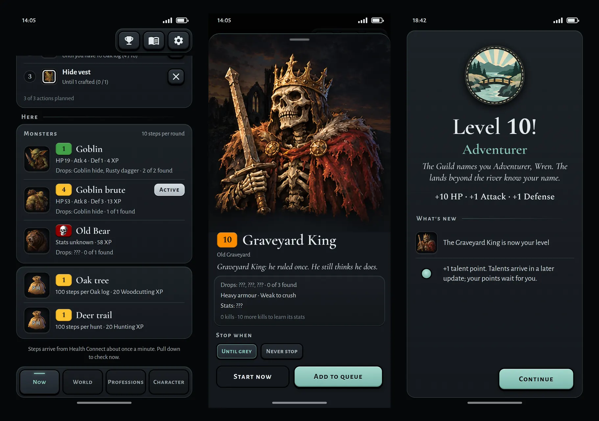
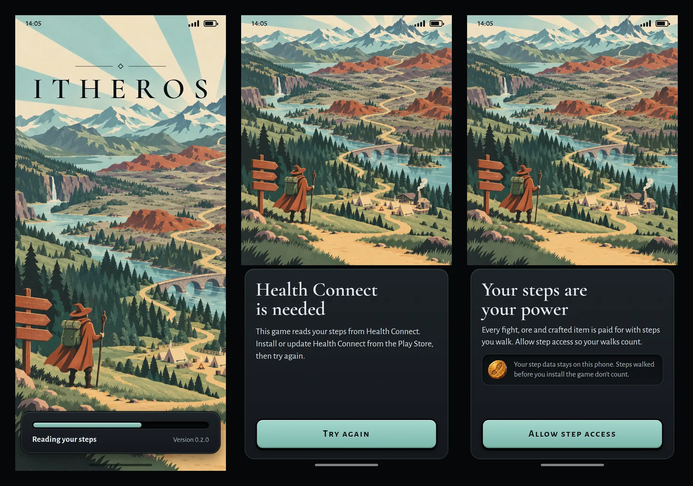

# Plan 0017: Build "Quiet Teal"

Status: draft
Spec: `specs/0014-quiet-teal.md` (accepted, ee6b54b) · Intent: `intent/0014-ui-style.md` (accepted, ee6b54b)
Product owner: Zkalf · Date: 2026-10-23

Names of files, widgets and tests refer to `main` at `ee6b54b`.

## Overview
This plan builds spec 0014 in five milestones. Each milestone is one pull request. M1 gives every screen the new
theme. M2 to M5 add the images, one group of screens at a time. Rules, numbers and save versions do not change.

| Milestone | Screens and parts | Criteria | Size |
|---|---|---|---|
| M1: Theme, controls and fonts | the theme on every screen; the top bar and the bottom bar; the fonts and the Licences page; the dark Android windows | 1–7, 27, 28 | about 1,370 lines |
| M2: Images, sockets and placeholders | the images and the placeholders; sockets and the PH mark; the doll, the bag, the item card, the Character header and "Who are you?"; the placeholder check | 8, 9, 11, 13–17, 23 | about 1,100 lines |
| M3: World, route and Achievements | World with the ring; the route and the route map; Achievements | 12, 18, 25, 26 | about 1,015 lines |
| M4: Now, monsters and each fact once | Now; Professions; monster rows and the monster sheet; banners; level-up; the seven repeats of §4.1 | 10, 19–22 | about 715 lines |
| M5: Splash, welcome and launcher | the splash; welcome; "Health Connect is needed"; the launcher | 24 | about 230 lines |

The sizes count the added lines of code and tests, not images. They are estimates from our earlier local build of
the same design. Each is below 1,500 lines. The milestone pull requests on `main` so far added up to 2,202 lines
(plan 0013 M1).

## Choices this plan makes
The owner may want to change one of these choices before he accepts the plan.
1. **Five milestones.** M4 and M5 can also be one pull request of about 945 lines.
2. **Today's widget types stay.** The theme and small wrappers draw the look on today's Material widgets. Thus only
   six old tests change. A custom tab bar alone would change five more tests.
3. **Images by file name.** At start, the app reads from the asset manifest which keys have an image. A new image
   needs no code change.
4. **A Licences page with the four font licences only.** Flutter's own licence page would also list each package.
5. **Place markers by today's four kinds:** forge, water, no monsters and monsters.
   - The boss marker of the design stays unused, so Old Graveyard shows the monsters marker.
   - Camp, Grey Moor and Mountain Pass have a forge, so all three show the forge marker.
6. **Tonal buttons are slate.** The plan reads "today's filled buttons" as `FilledButton` and `FilledButton.icon`.
   Swap, Eat, Go there and Open the World map are tonal buttons, so they are slate. The kit shows Eat in teal. The
   plan keeps teal for the main action.
7. **A pushed page keeps its title.** §2.2 says "A pushed page shows Back only." The plan reads this as "Back is its
   only button", because §4.1 removes titles only on tab screens.
8. **The tool line on Professions shows the image of the tool.** §4.2 says "Professions: as today, with the images and
   portraits of §3.1", and a tool is a thing of §3.1. Recipe rows stay as today.
9. **The status card on Now shows the marker of the place in a 48 dp socket.** This is the size for rows. The spec
   gives no size for the status card.
10. **Doll squares keep today's size:** the width divided by 4.5, from 48 dp to 72 dp. The socket fills the square.
    §2.3 gives no size for the doll.
11. **No release to friends from M2 to M4.** Each `main` between the milestones builds and passes its check. But from
    M2 to M4, some screens show images and other screens show icons.

## What changes in the code

### Theme, controls and fonts (M1)
- A new file, `app/lib/ui/theme.dart`, holds the colours of §2.1 and builds one dark theme. No colour comes from a seed
  colour. `WalkingRpgApp` uses this theme for each phone setting.
- `theme.dart` also names the neutral colours that the spec uses without a hex value:
  - black for the borders, the dark socket and the stroke of the PH mark;
  - white and transparent where today's code uses them.
- Component themes give today's controls the look of §2.2. Each button has the 2 dp black border in each state. A
  pressed button sinks. A focused button gets a teal ring.
- The button styles:

| Style | Buttons |
|---|---|
| Teal | each `FilledButton` and `FilledButton.icon`: Try again, Allow step access, Set out, Next, both Continue buttons, Start now, Add to queue, each Learn button, Save |
| Ghost | Cancel (two dialogs), Not now, Keep it, Skip all |
| Slate | all other buttons: each tonal, outlined, text and icon button, and the six profession buttons |

- The theme cannot tell a tonal button from a filled button. So each tonal button gets the slate style where the code
  builds it.
- The six profession buttons are a `Card` with an `InkWell` today. They become slate buttons with the border. Their
  keys and progress bars stay.
- These controls also get the border:
  - the four tabs of the bottom bar and the Journal's tabs;
  - the item list of "Until I have N" and the options of the gender dialog;
  - segments, chips and switches.
- Cards, sheets, dialogs, snack bars and both bars become plates. Controls that stand on the case today move onto a
  plate. Only the map stands on the case.
- Colours that the code sets today change to the colours of §2.1:
  - deep teal for the banners;
  - `#E08A7C` for short inputs and `#FBB15A` for the word "Risky";
  - the bar colours of §2.3. Each bar keeps its number.
- Status chips become outlines. A selected chip is lit and has a teal label.
- Status bar icons are light.
- Tab screens lose their title. The top bar keeps its three `IconButton`s and the `Badge` of its dot.
- The bottom bar stays a `NavigationBar`. A subclass of `NavigationDestination` draws the border of each tab.
- Fonts: nine files of the four families go in `app/assets/fonts/`, with the four SIL OFL 1.1 texts. The files come
  from Google Fonts. The pull request names the source of each file.

| Family | Weights | Use |
|---|---|---|
| Cormorant Garamond | 600 | the wordmark, titles and names |
| Alegreya Sans | 400, 700, 400 italic | body text, tab labels and the flavour lines |
| Alegreya Sans SC | 700, 800 | button labels and list headings (700); the PH mark (800) |
| Spectral | 500, 600, 700 | numbers that stand alone; the count badge (700) |

- Numbers that stand alone are the stat values, level numbers, the numbers on bars and the step counts on the map. A
  number in a sentence keeps the font of its sentence.
- Settings gets a Licences row. The row opens a new page, `LicencesScreen`, with the four licence texts from the app
  bundle. The page takes an optional `AssetBundle`, so its test reads the texts from disk.
- Android: these use `#060708`:
  - both window themes and both launch backgrounds;
  - new `values-v31` styles for the splash screen of Android 12 and later.

### Images, sockets and placeholders (M2)
- The images are WebP files in `app/assets/images/`. The folders are for monsters, items, achievements and ranks,
  places, players, placeholders and pictures. The file name is the key of §3.1.
- Icons are 256 px. Monster images are 512 px, because a boss image fills the width.
- A converter outside this repository makes the WebP files. The WebP files are the source (spec decision 5).
- `.gitattributes` gets `*.webp binary`. M1 adds `*.ttf binary`.
- A new `ImageIndex` (`app/lib/ui/images.dart`) holds the keys that have a file. `main` builds it from the asset
  manifest. Without an index, each thing shows its placeholder. Thus the old tests need no images.
- One function picks the image or the placeholder for each thing of §3.1. An item key with a quality, such as
  `hide_vest@rare`, shows the image `items/hide_vest`.
- A new socket widget draws the dark socket (72, 48 or 32 dp), the quality ring, the count badge and the PH mark.
- `ItemSquare` keeps its name and its fields, and shows a socket. In the bag, a 48 dp socket sits in the centre of
  today's grid cell.
- A table in the code gives each placeholder its PH spot: x, y, angle and scale.
- The placeholder check is a new test, `app/test/placeholders_test.dart`.
  - It lists each id that shows a placeholder.
  - It never fails because of a placeholder.
  - `check.ps1` already runs each test in `app/test/`, so `scripts/` does not change.

### The route (M3)
- `AwaySummary` gets one new field, `route`: a list of place ids.
  - The controller puts the start place first.
  - `AwaySummary._of` adds the place of each `Arrived` event. Today it drops these events.
  - Two merged summaries join their routes. If the second route starts where the first route ends, that place shows
    once.
  - An entry without `route` loads with an empty route.
- A route alone does not make a report eventful. `isEventful` does not change.
- The journal entry keeps the route inside its summary. `GameState.schemaVersion` stays 10, and `SaveData.version`
  stays 3. `packages/game_core` does not change.
- The route map is a strip of the map image:
  - The map image fills the width.
  - The strip runs from 48 dp above the highest place of the route to 48 dp below the lowest place.
  - The strip is at least 120 dp tall. It never runs past the top or the bottom of the map image.
  - A pure function computes the strip, and a unit test checks it.

### What does not change
- No file in `packages/game_core/` changes. Thus no rule, number or `data/*.json` file changes.
- The save versions (10 and 3) and the save fixtures stay.
- No package is new. The app gets no INTERNET permission and keeps `allowBackup="false"`.
- `scripts/`, `.github/`, `CLAUDE.md`, `.claude/` and `evals/` do not change.
- The structure of spec decision 1 stays.
- The words on the screens stay, except the words that the spec adds or removes.
- This plan does not build the talents screen or the daily chest.

## Old tests that change
Six tests change, all in `app/test/ui_test.dart`.
- Each test changes in the commit of the new tests of its milestone.
- The commit names the spec line that overrides the test, as in plan 0010.
- The other checks of each test stay.

| Test | Today it checks | After the change | Spec 0014 line | Milestone |
|---|---|---|---|---|
| "criterion 8: the bag stacks, gear first, icons differ" | a material icon on the material and not on gear; a blue border on rare gear and none on the material; the count "3" | the quality ring; no ring on the material; the count badge "×3" | 7; 79–81 | M2 |
| "a skull or red fight asks first" | the text "💀" | the skull image | 85 | M4 |
| "on the screen and in the journal, not as plain lines" | `Icons.emoji_events` in a banner | the image of the achievement | 8; 146 | M4 |
| "Now lists what this place offers, and starts it" | the heading "Here: Goblin Woods" | the heading "Here" | 131 | M4 |
| "at a forge a Forge row opens Professions" | the heading "Here: Camp" | the heading "Here" | 131 | M4 |
| "criteria 9 and 10: the card for bag gear, then Equip" | the stats twice, also as `compare-chest` | the stats once; no `compare-chest` | 133 | M4 |

Other tests read widget types, for example `NavigationBar`, `Badge`, `FilledButton`, `ListTile` and `ItemSquare`.
The plan keeps these types, so these tests stay as they are. In M4, one comment becomes false: the comment in
"criterion 13: the item card shows type, hands and bonus stats; list rows show none". M4 corrects it.

## Order of work
Each milestone follows these steps:
1. Make the branch `plan17-m<n>` from the newest `main`.
2. Write a test for each criterion of the milestone, with `MemorySaveStore`. Change the old tests of the milestone.
3. Commit the tests alone. A new test fails until the code changes, unless its criterion holds today.
4. Write the code.
5. Prove the milestone. Open the pull request and review it per `REVIEW.md`. The owner merges.

Rules for each milestone:
- No screen mixes the old theme with the new theme.
- Each criterion gets its test in one milestone.
- The tests for criteria 2, 3, 4 and 11 grow in each later milestone, and they stay green.
- Criteria 27 and 28 hold in each milestone.

The images show the look. If an image and the spec are different, the spec is correct.

### M1: Theme, controls and fonts

| Criterion | The test checks |
|---|---|
| 1 | For each phone setting, the app is dark, on `#060708`. The Android window themes, launch backgrounds and `v31` splash screen backgrounds use `#060708`. |
| 2 | Each colour of the theme and in `app/lib` is a colour of §2.1, a quality or band colour, or a neutral that `theme.dart` names. No other colour is warm. |
| 3 | The app bundles the nine font files. The text uses the families of the font table. Settings → Licences shows the four licence texts. |
| 4 | Each button, tab, chip, segment, switch and dropdown has the 2 dp black border in each state: default, pressed, focused, disabled and selected. This includes the profession buttons, the Journal's tabs and the options of the gender dialog. |
| 5 | Today's filled buttons are teal. Cancel, Not now, Keep it and Skip all are ghost buttons. All other buttons are slate. Each button keeps its words. |
| 6 | Each pushed page shows one Back button with the tooltip "Back". |
| 7 | The bottom bar has Now, World, Professions and Character. Each tab screen has Trophies with its dot, Journal and Settings, and no title. |
| 27 | The diff changes no file in `packages/game_core/`. The pacing tests pass. |
| 28 | `.\scripts\check.ps1 -Release` passes, with no INTERNET permission. The diff adds no package. |

**Old tests:** none.

**After the merge:** each screen has the new theme, fonts and buttons. Things keep today's icons until
their milestone.

**Size:** about 1,370 added lines of code and tests. The four licence texts add about 370 lines that are not code.

**Proof:** `.\scripts\check.ps1 -Release` green; the verifier checks the change against criteria 1–7, 27 and 28.
`.\scripts\device-smoke.ps1 -Install` once the owner says yes: the launch window and the app are dark on the phone.
Branch `plan17-m1`, pull request, review per `REVIEW.md`; the owner merges.

### M2: Images, sockets and placeholders

**Screens:** the doll, the bag, the item card, the Character header and "Who are you?". The item card has a 72 dp
socket and shows "Picture coming later" for a placeholder. The header shows the portrait next to the name and the rank
in teal.

| Criterion | The test checks |
|---|---|
| 8 | The Character header shows the name, the rank and origin, the eight stats and the talent line. Seven taps on the rank turn on the test walk. |
| 9 | The doll has 16 slots. The bag has 5 columns, with gear first. |
| 11 | The function gives each thing of §3.1 the image of its key, or else its placeholder. Gear never gets the material placeholder. The screens of M2 show that image. |
| 13 | Only placeholders have the PH mark. At 72, 48 and 32 dp, the mark has the colour, stroke and size of §3.2. The mark is never on the quality ring or below the count badge. The water icon and empty doll slots have no mark. |
| 14 | A placeholder has the semantics label "placeholder picture". The item card of a placeholder shows "Picture coming later". A real image has neither. |
| 15 | The placeholder check lists the ids that show a placeholder, and passes. With an extra item that has no image, it lists that item and passes. |
| 16 | A socket shows the image. With a count of 2 or more, it shows the count badge outside the lower right corner. With a count of 1, it shows no badge. |
| 17 | Gear and tools have a ring in their quality colour, `#E0E0E0` for Common. Materials and meals have no ring. |
| 23 | "Who are you?" cards and the Character header show the portrait for the origin and gender. The portrait changes when the player picks another gender. |

**Old tests:** "criterion 8: the bag stacks, gear first, icons differ".

**Size:** about 1,100 added lines of code and tests. Images: 111 files, about 3 MB.

**Proof:** `.\scripts\check.ps1 -Release` green; the verifier checks the change against criteria 8, 9, 11, 13–17 and
23, and that 2, 3, 4, 27 and 28 stay green. A phone install only if the owner asks. Branch `plan17-m2`, pull request,
review per `REVIEW.md`; the owner merges.

### M3: World, route and Achievements

**Screens:**
- World: the map image fills the width and has its own river. One teal ring marks the current place, in place of
  today's colour and pin. One rule places the names and the step plates.
- The away screen and the Journal's log: the route map, between the banners and the lines.
- Achievements: each row starts with its image. A locked achievement shows the locked patch. The list stays a list.

| Criterion | The test checks |
|---|---|
| 12 | A fogged place shows the fog marker. Mirror Lake and Smugglers' Cove show today's water icon. A locked achievement shows the locked patch. |
| 18 | With the app's fonts and a width of 360 dp, the test puts the player at each of the 12 places in turn. One teal ring marks the current place. Nothing on the map overlaps. Each name stays inside the map. |
| 25 | A walk over two days and two syncs keeps one route in its report. With two or more places, the away screen and the journal entry show the route map. |
| 26 | Each fixture in `app/test/fixtures/saves/` loads. Its journal entries have no route and show no route map. The save versions are 10 and 3. |

**Old tests:** none.

**Size:** about 1,015 added lines of code and tests. Images: the map image, about 0.6 MB.

**Proof:** `.\scripts\check.ps1 -Release` green; the verifier checks the change against criteria 12, 18, 25 and 26,
and that 2, 3, 4, 11, 27 and 28 stay green. The pull request shows screenshots of the route map. A phone install only
if the owner asks. Branch `plan17-m3`, pull request, review per `REVIEW.md`; the owner merges.

### M4: Now, monsters and each fact once

**Screens:**
- Now: the status card shows the marker of the place. The meal line and the monster rows start with their images.
- Professions: the tool line and the meal row of Cooking start with their images.
- The monster sheet starts with the image of the monster. A boss image fills the width and is at most 200 dp tall.
- The skull band shows the skull image.
- Banners: levels, lore notes, profession levels and the sea chart show text only. The other banners start with the
  image of the thing that they name.
- Level-up: the rank image on a new rank; images on the "What's new" rows of monsters and recipes.
- Each fact once: the seven repeats of §4.1 show once. The heading on Now is "Here". One heading "Monsters · 10 steps
  per round" stands above the monster rows.

| Criterion | The test checks |
|---|---|
| 10 | Each of the seven repeats of §4.1 shows once. The card for an empty slot drops the change line only if the line repeats the stats. |
| 19 | A tap on a monster opens one sheet that starts with its image. A boss shows its image across the full width, at most 200 dp tall. Stats stay unknown until 10 kills. |
| 20 | The skull band shows the skull image. Screen readers still say "Level: far too strong". |
| 21 | The banners for levels, lore notes, profession levels and the sea chart show text only. Each other banner starts with the image of the thing that it names. |
| 22 | The level-up card of a new rank shows the rank image. "What's new" rows start with the image of the monster, or of the item that a recipe makes. |

**Old tests:** "a skull or red fight asks first"; "on the screen and in the journal, not as plain lines"; "Now lists
what this place offers, and starts it"; "at a forge a Forge row opens Professions"; "criteria 9 and 10: the card for
bag gear, then Equip".

**Size:** about 715 added lines of code and tests. Images: the skull image.

**Proof:** `.\scripts\check.ps1 -Release` green; the verifier checks the change against criteria 10 and 19–22, and
that 2, 3, 4, 11, 27 and 28 stay green. A phone install only if the owner asks. Branch `plan17-m4`, pull request,
review per `REVIEW.md`; the owner merges.

### M5: Splash, welcome and launcher

**Screens:**
- The splash: the splash picture fills the screen. ITHEROS is near the top. A plate at the bottom holds the loading
  bar, "Reading your steps" and the version.
- Welcome and "Health Connect is needed": the splash picture is at the top. Below it are today's words and the teal
  button. The status bar icons are dark on the picture.
- The launcher: the emblem on `#060708`, and a one-colour emblem as the monochrome layer. The splash screen of
  Android 12 and later also shows the emblem.

| Criterion | The test checks |
|---|---|
| 24 | The splash shows the splash picture, ITHEROS and the loading bar. Welcome and "Health Connect is needed" show the same picture. The launcher files put the emblem on `#060708`. |

**Old tests:** none.

**Size:** about 230 added lines of code and tests. Images: the splash picture and the launcher files.

**Proof:** `.\scripts\check.ps1 -Release` green; the verifier checks the change against criterion 24, and that 2, 3,
4, 11, 27 and 28 stay green. `.\scripts\device-smoke.ps1 -Install` once the owner says yes: the launcher, the splash
screen and the splash show the emblem and the picture. Branch `plan17-m5`, pull request, review per `REVIEW.md`; the
owner merges.

## The placeholders
M2 needs 25 placeholders:
- one for each of the 14 slot kinds of gear;
- one for the tools of each of the 6 professions;
- one each for materials, meals, the player and monsters;
- the generic placeholder.

Nine exist. Sixteen are new: shoulder, cloak, bracer, gloves, belt, legs, ring and trinket; the six tools; the meal;
the player.
- nabriis makes the new ones with AI tools (spec decision 5) before M2's pull request opens.
- nabriis makes the one-colour emblem for M5 in the same way.
- Professions, teachers and areas get no placeholder (§6).

## Risks
| Risk | What we do |
|---|---|
| `main` changes a screen while a milestone is open | We fetch `main` before each milestone. We merge `main` into the open branch. We never force-push. |
| A Material control cannot take the look, and a test reads its type | A wrapper or a subclass draws the look, and the type stays. If no way exists, we stop and ask the owner before a test changes. |
| A milestone grows far past its estimate | M1 is the largest estimate, at about 1,370 lines. If a pull request grows far past its estimate, we stop and ask the owner whether to split it. |
| Names and step plates overlap on a small phone | A pure function places them. The criterion 18 test checks each rectangle at 360 dp, for each current place. |
| The new placeholders are late | M2's pull request waits for them. |
| The Android files are right, but the phone shows another colour | The `v31` styles set the splash screen of Android 12 and later. The M1 and M5 proofs install the app on the phone. |
| The map image has no lake at Mirror Lake and Smugglers' Cove | The water icon marks both places (§3.1). A later map image changes only the image. |
| The app grows | The fonts add about 2.5 MB. The images of M2 to M5 add about 4 MB. Spec concern 3 expects about 10 MB with all images. |
