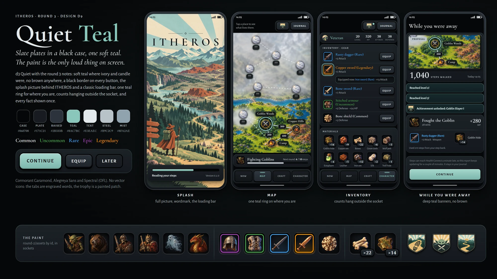
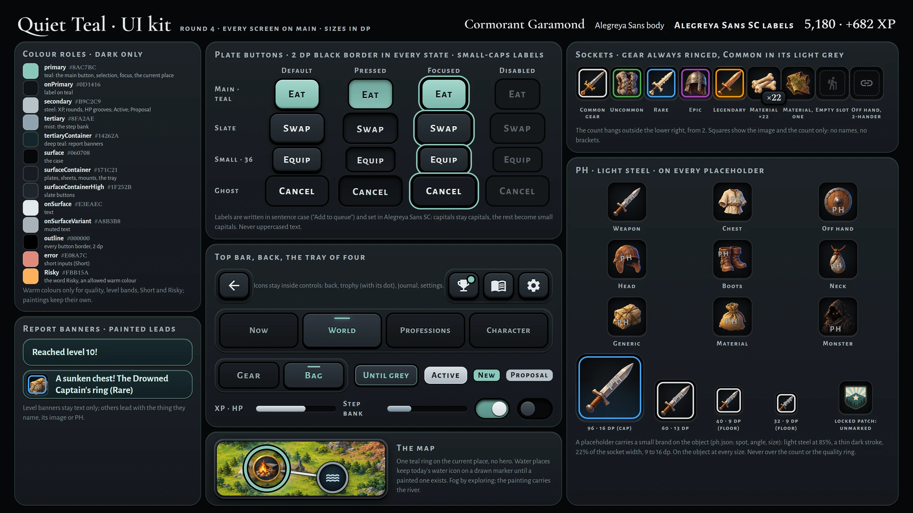
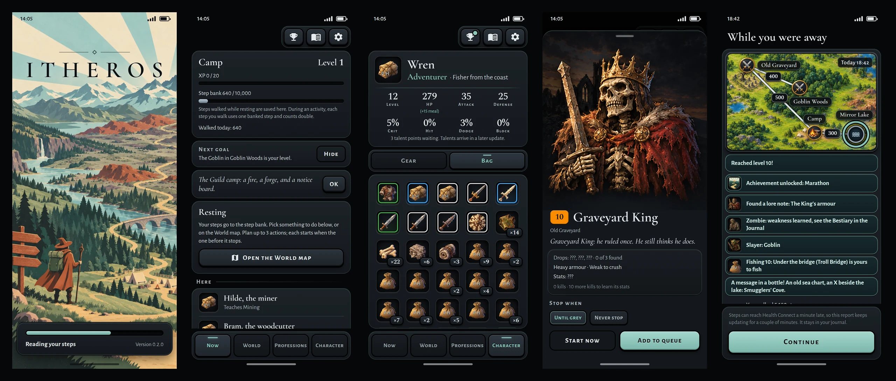

# Spec 0014: Quiet Teal (clean edition 1)

Status: accepted
Clean edition of: [spec 0014](0014-quiet-teal.md) with its amendments 1-10, and the parts of other specs that change
spec 0014 (see [Changes from other specs](#changes-from-other-specs))
Up to: 2026-11-11 (main f5f5c5b)
Issue: #59
Product owner: Zkalf

## How to read this edition
- This edition changes no rule, number, colour, size or criterion. It says in one file what spec 0014 and its changes
  say today.
- The accepted files stay the record. If this edition and an accepted file differ, the accepted file wins, and an
  erratum fixes this edition.
- The section numbers (§1-§8), the decision numbers (1-12) and the criterion numbers (1-28) are those of spec 0014.
  Code and tests that cite them stay right.
- A tag such as **(am. 4 change 1)** marks a text that came from an amendment.
- §8.7 keeps the criteria of each amendment under its own heading, with their own numbers. Amendments 5 and 6 go on
  with the series of spec 0014 (criteria 29-42). The other amendments start at 1.
- [Where each change went](#where-each-change-went) lists every amendment and its place here.
- A new change to spec 0014 is a new amendment of spec 0014, as before. A later clean edition folds it in.

Intent: [intent/0014-ui-style.md](../intent/0014-ui-style.md) (merged in #32 as 94bcdec, which accepts it;
renumbered in 23b96db)

Spec 0014 builds on:
- spec 0008 and its amendments 1-3;
- spec 0009 and its amendment 1;
- spec 0010 and its amendments 1-4 (and erratum 1);
- spec 0011 and spec 0012;
- spec 0004 amendments 2-3, spec 0005 amendment 3, spec 0006 amendment 2 and spec 0002 §9.2.

Spec 0014 overrides:
- intent 0008's "no art budget";
- spec 0008 §3.5's icons and corner count, and criterion 8's icons;
- spec 0004 amendment 3's banner icons;
- spec 0002 §3's 💀;
- spec 0006 criterion 11's drawn river;
- spec 0007 decision 5 (the launcher);
- the art and portrait lines that spec 0002 §10 and spec 0012 §7 put out of scope.

## Summary
- The app gets one look: slate plates on a black case, one soft teal, and a black border on each button.
- Monsters, items, achievements, places, gathering spots, professions and the map get images.
- A thing without an image shows a placeholder with the mark "PH". So the style can ship before all images exist.
- The screens, rules and numbers do not change.
- The away report gets a route map. This is the one data change.
- All sizes are in dp. The kit below gives the exact sizes and gradients.

The images show the look of 2026-10-22. If an image and this spec are different, the spec is correct.

## Changes from other specs
These specs change parts of spec 0014. This edition folds in the changes that replace a text or a number of spec
0014, with a tag such as **(spec 0008 am. 7)**. The other rows only point to the spec that owns the rule.

| Spec | What it changes in spec 0014 | Folded in |
|---|---|---|
| Spec 0008 amendment 7, erratum 1 | §2.3: the portrait in the Character header is 48 dp; criterion 8: the level beside the name and seven stats | §2.3, §4.2, criterion 8 |
| Spec 0008 amendment 8 | The Gear page is a grid of four columns with no figure, so criterion 9's "doll" has no figure | §4.2, criterion 9 |
| Spec 0015 amendments 3 and 6 | §4.3: the talents look like a tree, and each tree is a plate | §4.3 (pointer) |
| Spec 0020 amendment 2 | The kind chips of the bag and the bank have the selected look of amendment 4 | §2.2 (pointer) |
| Spec 0020 amendment 3 | The tabs of the bank screen are buttons in boxes, as the Journal's tabs are | §2.2 (pointer) |

## 1. Decisions

| # | Question | Decision |
|---|---|---|
| 1 | Style or structure? | **The style sets the look. The accepted structure stays:** the top and bottom bars, the doll, the bag, the Character header, fog by exploration, one sheet for each monster, and a report that looks like a journal entry. |
| 2 | Light or dark? | **Dark only.** This includes the Android windows. |
| 3 | Ship before all images exist? | **Yes.** The first build had images for 48 of the 178 items. The other items show a placeholder until their image exists. |
| 4 | Placeholders | **One for each kind or slot, and one generic.** Each placeholder has the PH mark in light steel. A real image never has the mark. |
| 5 | Images | **AI-made. The image files are their source.** The app keys the images by the game's ids and bundles them. No network code. No new packages. |
| 6 | Fonts | Cormorant Garamond, Alegreya Sans, Alegreya Sans SC and Spectral, under the **SIL OFL 1.1**. Settings shows the licences. |
| 7 | Icons | An icon for a thing (a monster, item, achievement, rank or place) becomes its image. Icons in controls stay. **Each profession shows a picture of its tool** **(am. 7)**. The Professions button in the bottom bar is a control, so it keeps its glyph. |
| 8 | Boss screen | **The monster's own sheet.** A boss shows its image across the full width. Each monster has one sheet. Stats stay hidden until 10 kills. |
| 9 | Portraits | Monsters use their images. The player's portrait follows origin and gender. The save has both. |
| 10 | Route map | The away report and its journal entry show the route (§5). |
| 11 | Talents | **The look only** (§4.3). The talent spec builds the screen. |
| 12 | Each fact once | Seven repeats go (§4.1). |

## 2. Look

### 2.1 Colours

| Role | Hex | Use |
|---|---|---|
| Case | `#060708` | the background |
| Plate | `#171C21` | cards, sheets, dialogs, snack bars, the top bar and the bottom bar |
| Slate | `#2B333B` to `#1E242A` | buttons and chips that are not selected |
| Selected | `#4C6768` (teal `#8AC7BC` at 35% over slate `#2B333B`) | a selected chip, segment, Journal tab or bottom bar tab **(am. 4 change 1)** |
| Lit | `#2E3740` | only the thumb of a switch that is off **(am. 4 change 5)** |
| Teal | `#8AC7BC`, text on it `#0D1416`; deep teal `#17292C` | main buttons, focus, the current place, earned things, "New", the rank, the loading bar; deep teal for banners |
| Steel, mist | `#B9C2C9`; `#8FA2AE` | steel for bars and the PH mark; mist for the step bank |
| Text | `#E3EAEC`, muted `#A8B3B8`, faint `#7F8A90` | body text, secondary text, small labels |
| Short, Risky | `#E08A7C`; `#FBB15A` | inputs that the player does not have; the word "Risky" |

- The game's quality and band colours stay.
- The interface uses no other warm colour.
- Status bar icons are light. They are dark on the splash picture.

### 2.2 Type, plates and buttons
**Type**
- Cormorant Garamond for the wordmark, titles and names.
- Alegreya Sans for body text and tab labels.
- Alegreya Sans SC (small caps) for button labels and list headings. The words do not change.
- Spectral for numbers.

**Plates**
- Radius 16, a 1 dp teal hairline, 6 dp apart.
- Only the map stands on the case. All other controls stand on a plate.

**Buttons**
- Each button has a **2 dp black border** in each state.
- The filled buttons of 2026-10-22 are teal.
- Cancel, Not now, Keep it and Skip all are ghost buttons (the border only).
- All other buttons are slate.
- A pressed button sinks. A focused button gets a teal ring.

**Chips, segments and tabs**
- Chips and segments are slate, with the border.
- A selected chip, segment, Journal tab or bottom bar tab has the selected fill `#4C6768`, a white `#FFFFFF` label,
  and a white icon where it has an icon **(am. 4 change 1)**.
- These controls have the selected look **(am. 4 change 2)**:
  - the segments, such as Gear and Bag on the Character tab and the gender on "Who are you?";
  - the choice chips and the filter chips, such as the stop choices, Auto-eat, Have mats, Have level and Up to 5
    levels ahead;
  - the tabs of the Journal: Log, Bestiary and Lore;
  - the open tab of the bottom bar: Now, World, Professions or Character.
- A chip, segment or Journal tab that is not selected stays slate with a light text label `#E3EAEC`
  **(am. 4 change 3)**.
- Status chips are outlines.
- The kind chips of the bag and the bank (spec 0020 amendment 2) and the tabs of the bank screen (spec 0020
  amendment 3) use the same selected look.

**The outline on button labels (am. 4 changes 6-9)**
- A thin black outline surrounds the letters of each button label: four black shadows of 0.8 dp, one on each side,
  with no blur.
- These labels have the outline:
  - slate buttons, such as Go there, Equip, Swap, Unequip, Change and Reroll;
  - ghost buttons: Cancel, Not now, Keep it and Skip all;
  - segments, choice chips and filter chips, selected or not;
  - the tabs of the Journal;
  - the labels of the bottom bar.
- These labels do not have the outline:
  - teal buttons. Their label is dark `#0D1416` on teal, and an outline makes it heavier, not clearer;
  - status chips, such as "Active". They are not buttons.
- Icons have no outline.
- The 2 dp black border, the shapes, the sizes, the fonts and the words of each control stay as they are
  **(am. 4 change 10)**.
- Text that is not on a button keeps its look: body text, titles, names, list headings and numbers
  **(am. 4 change 11)**.

**Top bar and bottom bar**
- Top bar: Trophies, Journal and Settings are slate icon buttons on a plate. A pushed page shows Back only.
- Bottom bar: a plate with the four tabs. Each tab shows its icon above its label.
- The open tab has the selected look **(am. 4 change 1)**.
- A tab that is not open has no fill, and a muted icon and label **(am. 4 change 4)**.

**New parts** follow the same rules. Examples:
- the profession buttons and filters;
- the card of the daily chest.

### 2.3 Sockets, counts, bars and the ring
**Sockets**
- Each image sits in a dark socket.

| Where | Size |
|---|---|
| Heads and portraits | 72 dp |
| The portrait in the Character header | 48 dp **(spec 0008 am. 7, erratum 1)** |
| Rows of the Achievements screen | 72 dp **(am. 3)** |
| The action sheet of a gather or a craft | 72 dp **(am. 8 change 8)** |
| Rows and the bag (monster rows, spot rows, recipe rows, the queue card) | 48 dp |
| Banners, and the lines of the materials table | 32 dp **(am. 9 change 6)** |

- On the Achievements screen, the socket stands at the start of the row, centred on the height of the row
  **(am. 3 change 2)**. The rows are a little taller, so fewer rows fit on one screen. The owner accepts this
  **(am. 3 change 4)**.
- Each other row of the game keeps its 48 dp socket **(am. 3 change 5)**.

**Quality**
- Gear and tools have a 2 dp ring in their quality colour. Common has `#E0E0E0`.
- Uncommon and higher also have a wash of that colour.
- Materials and meals have no ring. So gear never looks like a material.

**Count**
- A small badge with a border shows counts of 2 and more. It hangs off the lower right corner ("×14").

**Empty doll slot**
- The faint slot icon. It never has the PH mark.

**Bars**
- Bars are steel. The step bank is mist.
- The loading bar and unearned achievements are teal.
- Each bar keeps its number.

**Level badges**
- Level badges keep their look.
- The skull band shows a skull image in place of 💀. Screen readers still say "Level: far too strong".

**The ring**
- One teal ring marks the current place on the World map and on the route map. No other mark shows the current
  place.
- The code places the names and the step plates. These rules hold:
  - Nothing on the map overlaps: no two names, step plates or markers.
  - Each name lies inside the map, at most 8 dp from its marker.
  - Each step plate lies on its road.
  - **Own marker:** the marker nearest to the middle of a name is the marker of its own place **(am. 2 change 1)**.
  - **Roads:** a road can cross the edge of a name. The distance from the middle of a name to each road with a step
    plate is at least half the height of the name **(am. 2 change 2)**.
- **Name size:** the names on the map are 13 dp. They keep their font (Cormorant Garamond 600) and their colours
  **(am. 2 change 4)**.
- **Room for each place (am. 2 change 6):** the World map keeps room for each place and each road, also when the
  place is hidden or in the fog.
  - The placement uses the real name of each place and the step count of each road.
  - The map draws only what it drew before amendment 2: no hidden place, no hidden road, and no step count on a road
    into the fog.
  - A name in the fog ("???") stands inside the room of the real name, as near to its marker as it can.
  - So no name moves when the bottle reveals Smugglers' Cove or when a place leaves the fog.
- The rules of amendment 2 changes 1-4 also apply to the strip of the route map. The strip shows only the places of
  its route, so change 6 does not apply to it **(am. 2 change 7)**.
- **Places on the map (am. 2 change 5)** (`map` in `packages/game_core/data/world.json`, parts of the width and the
  height of the map):

  | Place | Before amendment 2 | Since amendment 2 |
  |---|---|---|
  | Camp | x 0.5, y 0.92 | x 0.36, y 0.92 |
  | Mirror Lake | x 0.72, y 0.94 | x 0.72, y 0.89 |
  | Copper Hills | x 0.8, y 0.8 | x 0.84, y 0.76 |

  - Camp moves left, so the camp of the map picture shows to the right of its marker.
  - The roads keep their step counts. Rules, numbers and the save do not change.

## 3. Images

### 3.1 What shows an image

| Thing | Key | Placeholder |
|---|---|---|
| Monster | its id | one |
| Gear | its item id | one for each slot kind |
| Tool | its item id | one for each profession |
| Material, meal | its item id | one for materials, one for meals |
| Achievement | its id | a locked achievement shows the locked patch |
| Rank | `rank_<name>` | the generic placeholder |
| Place | the fog marker if the place has fog; else its id; else its kind | a water place keeps its water icon until it has a marker |
| Player | origin and gender, for example `coast_fisher_female` | one |
| Gathering spot | `spots/<spot id>` | the tool placeholder of its profession **(am. 1)** |
| Profession | `professions/<id>` | the profession's glyph **(am. 7)** |
| Action in the queue | the picture of its thing (below) | the placeholder of that thing **(am. 8)** |

The style also has these pictures: the splash, the World map, the skull, the locked patch and the launcher emblem.

**Gathering spots (am. 1)**

| Profession | Spots | Placeholder |
|---|---|---|
| Mining | Copper vein, Iron vein, Mithril vein | `tool_mining` |
| Woodcutting | Oak tree, Ash tree, Pine tree | `tool_woodcutting` |
| Fishing | Lake shore, Under the bridge, Cove rocks, Cold tarn | `tool_fishing` |
| Hunting | Deer trail, Moor tracks, High crags | `tool_hunting` |

- A real image of a spot comes as content: the file `app/assets/images/spots/<spot id>.webp` **(change 9)**.

**Professions (am. 7)**
- Each profession has a picture, `professions/<id>.webp`. It shows the profession's tool in the iron tier:

  | Profession | Picture |
  |---|---|
  | Mining | pickaxe |
  | Woodcutting | hatchet |
  | Crafting | smith's hammer |
  | Fishing | rod |
  | Hunting | bow |
  | Cooking | cooking pot |

- A profession without a picture file shows its glyph **(change 3)**.
- `art/tools.py` draws the six pictures from the same shapes as the tools. `scripts/export-art.ps1` exports them
  **(change 4)**.
- The talent icons stay. The tool items keep their own pictures in the bag **(change 5)**.

**Actions (am. 8 changes 1-3)**

| Action | Picture |
|---|---|
| Fight | the monster |
| Gather | the spot |
| Craft | the item that the recipe makes |
| Reroll | the item that the player rerolls |
| Walk | the marker of the place |

- A thing without a picture file shows its placeholder, as everywhere (§3.2). No new picture is needed.
- The item of a craft or a reroll shows the ring of its quality when it is gear or a tool, as in the bag.

### 3.2 Placeholders and the PH mark
- A thing without an image shows the placeholder of its kind. If its kind has no placeholder, it shows the generic
  placeholder.
- Gear never shows the material placeholder.
- The app draws "PH" on the object, at a spot that each placeholder keeps (for example, the shaft of a boot).
- The mark is small caps in light steel at 85%, with a thin dark stroke.
- Its font size is 22% of the socket width, from 9 dp to 16 dp.
- It is never on the ring or below the count badge.
- Screen readers say "placeholder picture". The item card adds the line "Picture coming later".
- A check in `check.ps1` lists each id that shows a placeholder, spots included **(am. 1 change 8)**. The check
  never fails because of a placeholder. So new content does not need an image.

### 3.3 Splash, welcome and launcher
- **Splash:** the splash picture fills the screen. ITHEROS is near the top. A plate at the bottom holds the loading
  bar, "Reading your steps" and the version.
- **Welcome** and "Health Connect is needed": the same picture is at the top. Below it are the words and the teal
  button.
- **Launcher:** the emblem on `#060708`, and a one-colour version of it. Both Android window themes use `#060708`.
- **The emblem fills the icon (am. 10):**
  - The emblem and the one-colour emblem are about 74 dp across in the icon's 108 dp: a little more than the 72 dp
    that a round launcher shows. On a round icon no background shows **(change 1)**.
  - The picture of the emblem does not change, only its size in the icon files. The launcher crops its outer edge a
    little **(change 2)**.
  - The background layer stays `#060708`. A launcher with square or rounded-square icons still shows it in the
    corners **(change 3)**.
  - The splash screen uses the same file, so its emblem grows by the same share **(change 4)**.

## 4. Screens

### 4.1 Each fact once

| Where | Shown twice before spec 0014 | Kept |
|---|---|---|
| Tab screens | the name of the screen as the title and on the tab | the tab |
| Now | the place in the status card and in "Here: Camp" | the status card; the list heading is "Here" |
| Monster rows | "10 steps per round" on each row | one "Monsters · 10 steps per round" heading |
| Item card for an empty slot | the stats, and the same numbers as the change | the stats; the change line stays if it is different |
| Earned achievements | the goal, a full bar and "100 / 100" | the goal and a teal rim |
| World | the place in colour and a pin | the ring |
| Bestiary rows | "Slayer" and an icon | the word |

### 4.2 Screen by screen
**Now**
- The status card shows the marker of the place.
- Meal lines and monster rows start with their images.
- **Spot rows (am. 1 changes 3-4)** have the layout of a monster row, on Now "Here" and on the area sheet of the
  World map:
  - the row starts with the picture of the spot in a 48 dp socket;
  - the level badge is on the name line, before the name;
  - the badge keeps its colour and its number.
- The teacher rows under "Here" show the picture of the teacher's profession at 32 dp, with no socket
  **(am. 7 change 2)**.
- These rows keep their icons **(am. 1 change 5)**: the Forge row, the Camp fire row and the "Walk here" row.
- **The step bank (am. 6)**: a tap on the step bank row (its label and its bar) opens a sheet:
  - the title "Step bank";
  - "Steps walked while resting are saved here. During an activity, each step you walk uses one banked step and
    counts double.";
  - "Steps arrive from Health Connect about once a minute. Pull down to check now."
- Now shows neither of those two lines under the step bank or at the bottom of the screen **(am. 6 changes 2-3)**.
- The step bank bar and its label, "Walked today" and pull to refresh stay **(am. 6 change 5)**.

**The queue card (am. 8 changes 4-7, 10)**
- The row of the current action starts with its picture in a 48 dp socket, before the action's name.
- Each row of a waiting action starts with its picture in a 48 dp socket, in place of the number circle.
- The number of each row (1 for the current action, then 2, 3, …) is a small round badge on the top-left corner of
  its picture.
- When the queue has only one slot, the current action shows no number.
- A reroll shows no stop line, as a walk shows none. This holds for the current action and for a waiting one
  **(am. 9 change 9)**.
- The words, the stop lines, the bars, the tally, Stop, Remove and the tap that changes a stop condition stay.

**The action sheet (am. 8 changes 8-9)**
- The sheet of a gather or a craft starts with the picture in a 72 dp socket, beside the title.
- The sheet of a fight keeps the monster's card, with its picture (spec 0009 decision 11).

**World**
- The map image fills the width. The image has its own river.
- Markers, roads, step counts and fog keep their look.
- The line "Tap a place to see what lives there." does not show under the map **(am. 6 change 4)**.

**Monster sheet**
- Each monster has one sheet. The card starts with the image of the monster.
- A boss is a monster with first-kill drops. Its image fills the width and is at most 200 dp tall.

**Character**
- The portrait is next to the name, at 48 dp **(spec 0008 am. 7)**.
- The rank is teal.
- The Gear page and the bag show images. The Gear page is a grid of four columns with no figure (spec 0008
  amendment 8).

**Away report and Journal**
- Banners for levels, lore, professions and the sea chart are text only.
- The other banners start with the image of the thing that they name.
- The route map is between the banners and the lines.

**Professions (am. 7, am. 9)**
- The card of each profession in the Professions tab shows the picture of its profession at 32 dp, with no socket,
  before its name.
- The header of each profession screen shows the picture of its profession at 32 dp, before its name.
- The Professions button in the bottom bar keeps its glyph (decision 7).
- **Recipe rows (am. 9 changes 1-5):**
  - Each recipe row starts with the picture of the item that it makes, in a 48 dp socket.
  - Gear and tools show the ring of their quality, as in the bag. Meals and materials have no ring.
  - The level badge is on the title line, before the recipe's name, as in a monster row or a spot row. It keeps its
    colour.
  - The words of the row stay: the kind, the stats, the materials, "Enough for N", the steps and the XP, or why it is
    locked.
  - A tap on the row opens the action sheet. The row does not open the item card: its subtitle already shows the
    item's stats, and the sheet shows the picture large.
- **The materials table (am. 9 changes 6-8):**
  - Each line starts with the material's picture in a 32 dp socket, before its name.
  - A tap on a line opens the material's card: where it comes from and what uses it. The card has no buttons.
  - The columns Have, Uses and Left stay.

**Achievements (am. 3)**
- Each row starts with its picture in a 72 dp socket.
- The row keeps the name, the "Feat" chip, the goal, the "Reward:" line and the bar with its numbers, the "New" chip
  at the end, the teal rim of an earned achievement, and the locked patch for a locked achievement.

**Level-up, "Who are you?"**
- They show the images and portraits of §3.1.

**Settings**
- A **Licences** row shows the licences of the four fonts.

**Going back (am. 5)**
- **Swipe right anywhere:** on a screen that slid in, a swipe to the right that starts anywhere on the screen goes
  back. The screen follows the finger, as the edge swipe does **(change 1)**.
- **Let go halfway:** a swipe that ends before the middle of the screen, and slowly, slides the screen back in. A
  quick swipe goes back from any distance. These are the rules of the edge swipe **(change 2)**.
- **Taps stay taps:** a tap, or a touch that moves less than the touch slop of the phone (about 18 dp), never starts
  a swipe. A tap on a recipe, a button or a row works as before **(change 3)**.
- **Scrolls stay scrolls:** a touch that moves more up or down than to the side scrolls the screen **(change 4)**.
- **A swipe to the left** does nothing **(change 5)**.
- **Where it does not apply (change 6):**
  - the tabs of the bottom bar (they did not slide in);
  - sheets and dialogs;
  - a screen with a part that scrolls or drags to the side. It keeps only the edge swipe.
- The slide-in of #141, the Back button, the phone's back button and the edge swipe stay **(change 7)**.

### 4.3 Talents (the look only)
- Spec 0014's look for the talent spec:
  - A heading shows the points that are left.
  - Each path has a plate with an image, a name and one line.
  - Teal pips show the steps. A taken step is filled.
  - The spend button is slate.
- Spec 0015 amendment 3 replaced it with a tree: icons on a grid, with lines between them. Spec 0015 amendment 6 put
  each tree on a plate of its own. Spec 0015 owns the look of the talents now.

## 5. The one data change: the route
- A report keeps a route.
  - The route starts at the place where the player was.
  - Then it lists each place where the player arrived.
  - Two merged reports join their routes.
- If the route has two or more places, the report and its journal entry show a strip of the map. The strip shows
  the roads walked, the places passed and the ring on the last place.
- The game saves the route with the journal entry.
- An older entry loads with no route and shows no map.
- The save versions stay at 10 and 3. Each fixture loads.

## 6. Out of scope
- A fight scene and animation.
- The talent rules.
- A separate boss screen.
- A light theme.
- An appearance editor.
- Images for teachers and areas. A gathering spot is not an area **(am. 1 change 7)**. Professions got pictures in
  amendment 7.
- Changes to rules or numbers.

The missing images come later as content.

## 7. Concerns
1. **Many placeholders at first** (intended): three items in four, and all tools, meals and portraits.
2. **Tests for the old look:** about six tests change by design. The plan names each test.
3. **Size:** with all images, the app is about 10 MB larger.

## 8. Acceptance criteria
The base criteria keep their numbers. A criterion that checks several things has a letter for each check (rule 13
of `WRITING.md`). A note says where a later change moved a check.

### 8.1 Look
1. Dark:
   - 1a. The app is dark for each phone setting.
   - 1b. The Android launch window and normal window are dark (`#060708`).
2. Colours:
   - 2a. The app uses the colours of §2.1.
   - 2b. It uses no other warm colour.
   - 2c. Each colour literal in `app/lib/` is a colour of §2.1, a quality or band colour, black, white or transparent
     (am. 4 criterion 12).
3. Fonts:
   - 3a. The app bundles the four fonts and uses them as §2.2 says.
   - 3b. Settings has a Licences row with their licence texts.
4. Each button, tab, chip, segment and switch has the 2 dp black border in each state.
5. Buttons:
   - 5a. Teal, ghost and slate buttons are as §2.2 says.
   - 5b. Each button keeps its words.
6. Back keeps its "Back" tooltip.

### 8.2 Structure that stays
7. Bars:
   - 7a. The bottom bar has Now, World, Professions and Character.
   - 7b. The top bar has Trophies with its dot, Journal and Settings on each tab screen.
   - 7c. Tab screens have no title.
8. The Character header:
   - 8a. It keeps the name, the rank and the origin, and the talent line.
   - 8b. The level stands beside the name, and the seven stats stand in their row. This replaces "the eight stats"
     (spec 0008 amendment 7, erratum 1).
   - 8c. Seven taps on the rank still turn on the test walk.
   - The test of an origin that does not fit uses a phone 320 dp wide (spec 0008 amendment 7, erratum 1 correction 4).
9. The Gear page and the bag:
   - 9a. The Gear page keeps 16 slots. Since spec 0008 amendment 8, it shows them in a grid of four columns with no
     figure.
   - 9b. The bag keeps 5 columns, with gear first.
10. Each fact once:
    - 10a. Each repeat of §4.1 shows once.
    - 10b. The item card for an empty slot drops the change line only if the line repeats the stats.

### 8.3 Images and placeholders
11. Images:
    - 11a. Each thing in §3.1 shows its image by its key.
    - 11b. A thing without an image shows its placeholder.
    - 11c. Gear never shows the material placeholder.
12. Places and achievements:
    - 12a. A fogged place shows the fog marker.
    - 12b. A water place without a marker shows the water icon.
    - 12c. A locked achievement shows the locked patch.
13. The PH mark:
    - 13a. Only placeholders have the PH mark.
    - 13b. The mark is as §3.2 says.
    - 13c. The water icon and empty doll slots have no mark.
14. Screen readers and the item card:
    - 14a. Screen readers say "placeholder picture" for a placeholder.
    - 14b. The item card of a placeholder says "Picture coming later".
15. The check of §3.2 lists the placeholders and passes. Content without an image also passes.
16. A socket shows the image. For 2 or more, it also shows the count badge outside the lower right corner.
17. Rings:
    - 17a. Gear and tools have a ring in their quality colour, Common included.
    - 17b. Materials and meals have no ring.

### 8.4 Screens
18. The map:
    - 18a. One teal ring marks the current place.
    - 18b. At a width of 360 dp, nothing on the map overlaps.
    - 18c. Each name stays inside the map.
19. Monster sheets:
    - 19a. A tap on a monster opens one sheet with its image.
    - 19b. A boss shows its image across the full width.
    - 19c. Stats stay unknown until 10 kills.
20. The skull band shows the skull image. Screen readers still say "Level: far too strong".
21. Each banner shows text or an image, as §4.2 says.
22. Level-up and "What's new":
    - 22a. The level-up card of a new rank shows the rank image.
    - 22b. "What's new" rows start with the image of the monster, or of the item that a recipe makes.
23. Portraits:
    - 23a. "Who are you?" cards and the Character header show the portrait for the origin and gender.
    - 23b. The portrait changes when the player picks another gender.
24. Splash, welcome and launcher:
    - 24a. The splash shows the picture, ITHEROS and the loading bar.
    - 24b. Welcome and "Health Connect is needed" show the same picture.
    - 24c. The launcher shows the emblem on `#060708`. Amendment 10 criteria 1-3 say how large.

### 8.5 Route and save
25. The route:
    - 25a. A report keeps its route across syncs and days.
    - 25b. With two or more places, it shows the route map on the away screen and in its journal entry.
26. The save:
    - 26a. An entry from before spec 0014 loads and shows no map.
    - 26b. The save versions stay at 10 and 3.
    - 26c. Each fixture in `app/test/fixtures/saves/` loads.

### 8.6 Rules and build
27. Rules and numbers do not change. The pacing test passes.
28. `.\scripts\check.ps1 -Release` passes. The app has no INTERNET permission and no new package.

### 8.7 Criteria of the amendments
Each amendment keeps its own numbers.

**Amendment 1** (pictures for gathering spots)
- Spot rows:
  1. On Now "Here", each spot row starts with a 48 dp socket.
  2. On the area sheet of the World map, each spot row starts with a 48 dp socket.
  3. A spot without an image shows the tool placeholder of its profession, as the table of §3.1 says.
  4. A spot with an image file `spots/<spot id>` shows that image, without the PH mark.
  5. The level badge of a spot is on the name line, before the name.
  6. The level badge of a spot keeps the colour and the number that it showed before amendment 1.
- Other rows:
  7. The profession buttons and the profession screens keep their icons. Amendment 7 later gave the professions
     their pictures (amendment 7 criteria 2-3).
  8. The teacher, Forge, Camp fire and "Walk here" rows keep their icons. Amendment 7 later gave the teacher rows the
     picture of their profession (amendment 7 criterion 4).
- Check and release:
  9. The placeholder check lists each spot that shows a placeholder and passes.
  10. Rules, numbers and the save do not change. The pacing test passes.
  11. `.\scripts\check.ps1 -Release` is green, and the release build declares no INTERNET permission.

**Amendment 2** (names on the map stay next to their place)
- Placement:
  1. At 360 dp, for each of the 12 places as the current place, the marker nearest to the middle of each name is the
     marker of its own place.
  2. At 360 dp, for each current place, the distance from the middle of each name to each road with a step plate is
     at least half the height of the name.
  3. At 360 dp, for each current place, criterion 18 of spec 0014 still holds: nothing overlaps, and each name stays
     inside the map.
  4. The names on the map are 13 dp.
- Names do not move:
  5. At 360 dp, with Camp as the current place, each name has the same rect before and after the bottle reveals
     Smugglers' Cove.
  6. At 360 dp, with Camp as the current place, the "???" name of a place in the fog lies inside the rect that its
     real name has when the place leaves the fog.
  7. At 360 dp, the World map draws no hidden place, no road to a hidden place, and no step count on a road into the
     fog.
- Places:
  8. Camp, Mirror Lake and Copper Hills have the map points of the table in §2.3.
  9. Each other place keeps its map point.
- Check and release:
  10. Rules, numbers and the save do not change. The pacing test passes.
  11. `.\scripts\check.ps1 -Release` is green, and the release build declares no INTERNET permission.

**Amendment 3** (72 dp pictures on the Achievements screen)
- Achievement rows:
  1. Each row of the Achievements screen starts with a 72 × 72 dp socket.
  2. A locked achievement shows the locked patch in the socket. An earned achievement shows its image.
  3. The socket is centred on the height of its row.
  4. The name, the goal, the "Reward:" line, the bar and the "New" chip still show in the row.
- Other rows:
  5. The monster rows and the spot rows on Now "Here" keep their 48 dp sockets.
- Check and release:
  6. Rules, numbers and the save do not change. The pacing test passes.
  7. `.\scripts\check.ps1 -Release` is green, and the release build declares no INTERNET permission.

**Amendment 4** (a clear selected look, and an outline on button labels)
- Selected look:
  1. A selected segment has the fill `#4C6768`, a white label and a white icon.
  2. A selected choice chip and a selected filter chip have the fill `#4C6768` and a white label.
  3. The open tab of the Journal has the fill `#4C6768` and a white label.
  4. A segment, chip or Journal tab that is not selected has the fill slate `#2B333B` and the label `#E3EAEC`.
  5. The open tab of the bottom bar has the fill `#4C6768`, a white icon and a white label. The other tabs have no
     fill and a muted icon and label.
- Outline:
  6. The label of a slate button has the four black shadows of 0.8 dp with no blur.
  7. The label of a ghost button has the outline.
  8. The label of each segment, choice chip, filter chip and Journal tab has the outline, selected or not.
  9. Each label of the bottom bar has the outline.
  10. The label of a teal button has no shadow.
  11. A status chip has no shadow.
- Colours:
  12. Each colour literal in `app/lib/` is a colour of §2.1 with this amendment, a quality or band colour, black,
      white or transparent (spec 0014 criterion 2).
- Check and release:
  13. Rules, numbers and the save do not change. The pacing test passes.
  14. `.\scripts\check.ps1 -Release` is green, and the release build declares no INTERNET permission.

**Amendment 5** (swipe right to go back)
- Swipe back:
  29. A swipe to the right from the middle of a profession's screen goes back to Professions.
  30. A tap on a recipe row of a profession's screen opens the recipe, and does not go back.
  31. A short slow swipe to the right, less than a third of the screen, leaves the profession's screen open.
  32. A vertical scroll on a profession's screen scrolls it, and does not go back.
  33. A swipe to the left on a profession's screen does not go back.
  34. A swipe to the right on the Now tab changes nothing.
- Check and release:
  35. Rules, numbers and the save do not change. The pacing test passes.
  36. `.\scripts\check.ps1 -Release` is green, and the release build declares no INTERNET permission.

**Amendment 6** (fewer words on Now and World)
- Now:
  37. Now does not show "Steps walked while resting are saved here."
  38. Now does not show "Steps arrive from Health Connect about once a minute."
  39. A tap on the step bank opens a sheet with the title "Step bank" and both lines.
- World:
  40. The World tab does not show "Tap a place to see what lives there."
- Check and release:
  41. Rules, numbers and the save do not change. The pacing test passes.
  42. `.\scripts\check.ps1 -Release` is green, and the release build declares no INTERNET permission.

**Amendment 7** (a picture for each profession)
- Pictures:
  1. Each of the six professions has a file `professions/<id>.webp`.
  2. Each profession card in the Professions tab shows the picture of its profession, at 32 dp.
  3. The header of each profession screen shows the picture of its profession, at 32 dp.
  4. A teacher row under "Here" on Now shows the picture of the teacher's profession, at 32 dp.
  5. A profession without a picture file shows its glyph in each of the three places.
  6. The Professions tab button in the bottom bar shows its glyph.
- Check and release:
  7. Rules, numbers and the save do not change.
  8. `.\scripts\check.ps1 -Release` is green, and the release build declares no INTERNET permission.

**Amendment 8** (pictures for the actions in the queue)
- The queue card:
  1. The current action's row starts with the picture of its thing in a 48 dp socket, for a fight, a gather, a craft
     and a walk.
  2. Each waiting action's row starts with the picture of its thing in a 48 dp socket, for a fight, a gather, a
     craft, a reroll and a walk.
  3. A craft of gear shows the ring of the quality of its item.
  4. A reroll shows the ring of the quality of the item that the player rerolls.
  5. Each waiting row shows its number as a badge on its picture: 2, 3, ….
  6. With two or more slots, the current action shows the badge 1 on its picture.
  7. With one slot, the current action shows no number.
  8. No waiting row shows the old number circle beside its picture.
  9. A tap on a waiting row still opens its change sheet, and Remove still removes it.
- The action sheet:
  10. The sheet of a gather starts with the spot's picture in a 72 dp socket, beside the title.
  11. The sheet of a craft starts with the picture of the item that it makes, in a 72 dp socket, beside the title.
  12. The sheet of a fight still starts with the monster's card.
- Check and release:
  13. Rules, numbers and the save do not change. The pacing test passes.
  14. The queue card and the action sheet are rendered at 408 dp wide before the PR (`CLAUDE.md`).
  15. `releases/next/` has a line for players.
  16. `.\scripts\check.ps1 -Release` is green, and the release build declares no INTERNET permission.

**Amendment 9** (pictures on recipe rows and in the materials table)
- The recipe rows:
  1. Each recipe row on the Crafting screen starts with the picture of the item that it makes, in a 48 dp socket.
  2. Each recipe row on the Cooking screen starts with the picture of the meal that it makes, in a 48 dp socket.
  3. A gear or tool recipe shows the ring of its item's quality.
  4. A meal recipe shows no ring.
  5. The level badge stands on the title line, before the recipe's name.
  6. A locked recipe also shows its picture, and its badge keeps the colour of a locked recipe.
  7. A tap on a recipe row still opens its action sheet.
- The materials table:
  8. Each line of the materials table starts with the material's picture in a 32 dp socket, before its name.
  9. A tap on a line opens the card of that material.
  10. The card of a material from the table shows no buttons.
- The stop line of a reroll:
  11. A waiting reroll on the queue card shows no stop line.
  12. A current reroll on the queue card shows no stop line.
  13. A waiting fight still shows its stop line.
- Check and release:
  14. Rules, numbers and the save do not change. The pacing test passes.
  15. The Crafting screen, the Cooking screen and the sheet of a craft are rendered at 408 dp wide before the PR
      (`CLAUDE.md`).
  16. `releases/next/` has a line for players.
  17. `.\scripts\check.ps1 -Release` is green, and the release build declares no INTERNET permission.

**Amendment 10** (the emblem fills the launcher icon)
1. In each density, the emblem covers the whole circle of 72 dp in the centre of the 108 dp icon: no pixel inside it
   is transparent.
2. The one-colour emblem has the same size as the emblem, and still one colour.
3. The adaptive icon keeps its three layers: the background `#060708`, the emblem and the one-colour emblem.

## Where each change went

| File | Its changes | Place in this edition |
|---|---|---|
| [Amendment 1](0014-quiet-teal.amendment-1.md) | 1-2 spots in §3.1 and their placeholders; 3-5 spot rows; 6-7 decision 7 and §6; 8 the placeholder check; 9 spot files | §3.1; §3.2; §4.2 "Now"; §6; §8.7 |
| [Amendment 2](0014-quiet-teal.amendment-2.md) | 1-3 placement rules; 4 13 dp names; 5 three map points; 6 room for hidden places; 7 the route strip | §2.3 "The ring"; §8.7 |
| [Amendment 3](0014-quiet-teal.amendment-3.md) | 1-5 72 dp achievement rows | §2.3 "Sockets"; §4.2 "Achievements"; §8.7 |
| [Amendment 4](0014-quiet-teal.amendment-4.md) | 1-5 the selected look; 6-9 the label outline; 10-11 what stays | §2.1; §2.2; criterion 2c; §8.7 |
| [Amendment 5](0014-quiet-teal.amendment-5.md) | 1-7 swipe right to go back | §4.2 "Going back"; §8.7 |
| [Amendment 6](0014-quiet-teal.amendment-6.md) | 1-3 the step bank sheet; 4 no map hint; 5 what stays | §4.2 "Now", "World"; §8.7 |
| [Amendment 7](0014-quiet-teal.amendment-7.md) | 1 profession pictures; 2 where they show; 3 no file; 4 the art; 5 what stays | decision 7; §3.1; §4.2 "Now", "Professions"; §6; §8.7 |
| [Amendment 8](0014-quiet-teal.amendment-8.md) | 1-3 the picture of an action; 4-7 the queue card; 8-9 the action sheet; 10-11 what stays | §2.3; §3.1; §4.2 "The queue card", "The action sheet"; §8.7 |
| [Amendment 9](0014-quiet-teal.amendment-9.md) | 1-5 recipe rows; 6-8 the materials table; 9 no stop line for a reroll | §2.3; §4.2 "Professions", "The queue card"; §8.7 |
| [Amendment 10](0014-quiet-teal.amendment-10.md) | 1-4 the emblem fills the icon | §3.3; criterion 24c; §8.7 |
