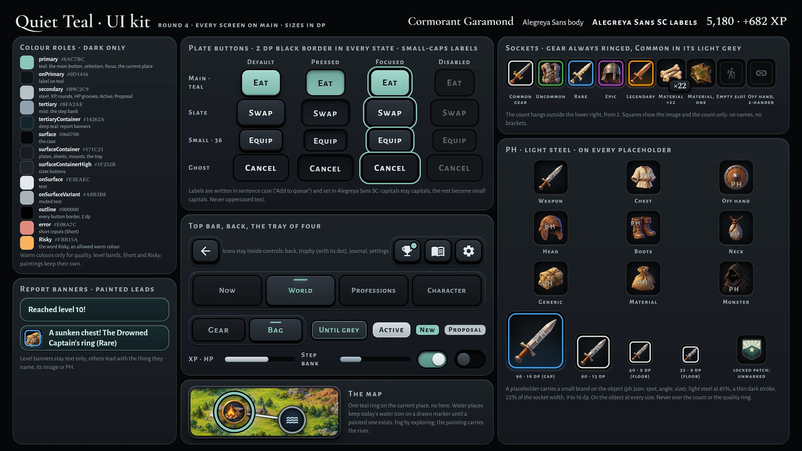
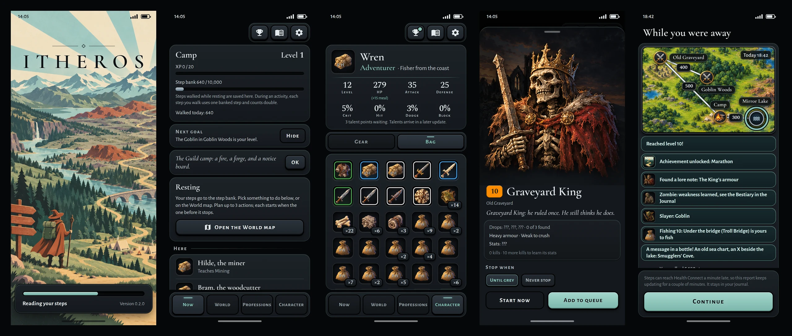

# Spec 0014: Quiet Teal

Status: draft
Intent: [intent/0014-ui-style.md](../intent/0014-ui-style.md) (merged in #32 as 94bcdec, which accepts it; renumbered in 23b96db)
Builds on: spec 0008 + amendments 1–3, spec 0009 + amendment 1, spec 0010 + amendments 1–4 (and erratum 1),
spec 0011, spec 0012, spec 0004 amendments 2–3, spec 0005 amendment 3, spec 0006 amendment 2, spec 0002 §9.2
Overrides: intent 0008's "no art budget"; spec 0008 §3.5's icons and corner count, and criterion 8's icons; spec 0004
amendment 3's banner icons; spec 0002 §3's 💀; spec 0006 criterion 11's drawn river; spec 0007 decision 5 (launcher);
the art and portrait lines out of scope in spec 0002 §10 and spec 0012 §7
Product owner: Zkalf
Date: 2026-10-22

The app gets one look: slate plates on a black case, one soft teal and a black border on each button. Monsters,
items, achievements, places and the map get images. A thing without an image shows a placeholder with the mark "PH".
Thus the style can ship before all images exist. The screens, rules and numbers do not change. The away report gets
a route map. This is the one data change. All sizes are in dp. The kit below gives the exact sizes and gradients.

The images show the look. If an image and this spec are different, the spec is correct.

## 1. Decisions

| # | Question | Decision |
|---|---|---|
| 1 | Style or structure? | **The style sets the look. The accepted structure stays:** the top and bottom bars, the doll, the bag, the Character header, fog by exploration, one sheet for each monster, and a report that looks like a journal entry. |
| 2 | Light or dark? | **Dark only.** This includes the Android windows. |
| 3 | Ship before all images exist? | **Yes.** The build has images for 48 of the 178 items. The other items show a placeholder until their image exists. |
| 4 | Placeholders | **One for each kind or slot, and one generic.** Each placeholder has the PH mark in light steel. A real image never has the mark. |
| 5 | Images | **AI-made. The image files are their source.** The app keys the images by the game's ids and bundles them. No network code. No new packages. |
| 6 | Fonts | Cormorant Garamond, Alegreya Sans, Alegreya Sans SC and Spectral, under the **SIL OFL 1.1**. Settings shows the licences. |
| 7 | Icons | An icon for a thing (a monster, item, achievement, rank or place) becomes its image. Icons in controls stay. Professions keep their icons. |
| 8 | Boss screen | **The monster's own sheet.** A boss shows its image across the full width. Each monster has one sheet. Stats stay hidden until 10 kills. |
| 9 | Portraits | Monsters use their images. The player's portrait follows origin and gender. The save has both. |
| 10 | Route map | The away report and its journal entry show the route (§5). |
| 11 | Talents | **The look only** (§4.3). The talent spec builds the screen. |
| 12 | Each fact once | Seven repeats go (§4.1). |

## 2. Look

### 2.1 Colours

| Role | Hex | Use |
|---|---|---|
| Case | `#060708` | the background |
| Plate | `#171C21` | cards, sheets, dialogs, snack bars, the top bar and the bottom bar |
| Slate | `#2B333B` to `#1E242A`, lit `#2E3740` | buttons and chips; the lit tab and selected chips |
| Teal | `#8AC7BC`, text on it `#0D1416`; deep teal `#17292C` | main buttons, focus, the current place, earned things, "New", the rank, the loading bar; deep teal for banners |
| Steel, mist | `#B9C2C9`; `#8FA2AE` | steel for bars and the PH mark; mist for the step bank |
| Text | `#E3EAEC`, muted `#A8B3B8`, faint `#7F8A90` | body text, secondary text, small labels |
| Short, Risky | `#E08A7C`; `#FBB15A` | inputs that the player does not have; the word "Risky" |

The game's quality and band colours stay. The interface uses no other warm colour. Status bar icons are light. They
are dark on the splash picture.

### 2.2 Type, plates and buttons
- **Type:** Cormorant Garamond for the wordmark, titles and names. Alegreya Sans for body text and tab labels.
  Alegreya Sans SC (small caps) for button labels and list headings. The words do not change. Spectral for numbers.
- **Plates:** radius 16, a 1 dp teal hairline, 6 dp apart. Only the map stands on the case. All other controls
  stand on a plate.
- **Buttons:** each button has a **2 dp black border** in each state. Today's filled buttons are teal. Cancel, Not
  now, Keep it and Skip all are ghost buttons (the border only). All other buttons are slate. A pressed button sinks.
  A focused button gets a teal ring.
- **Chips and segments** are slate, with the border. A selected chip is lit and has a teal label. Status chips are
  outlines.
- **Top bar:** Trophies, Journal and Settings are slate icon buttons on a plate. A pushed page shows Back only.
- **Bottom bar:** a plate with the four tabs. Each tab shows its icon above its label. The lit tab is teal.
- New parts follow the same rules. Examples:
  - the profession buttons and filters;
  - the card of the daily chest.

### 2.3 Sockets, counts, bars and the ring
- **Sockets:** each image sits in a dark socket. Sizes: 72 dp in heads and portraits, 48 dp in rows and the bag,
  32 dp in banners.
- **Quality:** gear and tools have a 2 dp ring in their quality colour. Common has `#E0E0E0`. Uncommon and higher
  also have a wash of that colour. Materials and meals have no ring. Thus gear never looks like a material.
- **Count:** a small badge with a border shows counts of 2 and more. It hangs off the lower right corner ("×14").
- **Empty doll slot:** the faint slot icon, as today. It never has the PH mark.
- **Bars:** steel. The step bank is mist. The loading bar and unearned achievements are teal. Each bar keeps its
  number.
- **Level badges** stay as today. The skull band shows a skull image in place of 💀. Screen readers still say
  "Level: far too strong".
- **The ring:** one teal ring marks the current place on the World map and on the route map. No other mark shows the
  current place. The code places names and step plates. Nothing overlaps, and each name stays inside the map.

## 3. Images

### 3.1 What shows an image

| Thing | Key | Placeholder |
|---|---|---|
| Monster | its id | one |
| Gear | its item id | one for each slot kind |
| Tool | its item id | one for each profession |
| Material, meal | its item id | one for materials, one for meals |
| Achievement | its id | a locked achievement shows the locked patch |
| Rank | `rank_<name>` | the generic placeholder |
| Place | the fog marker if the place has fog; else its id; else its kind | a water place keeps today's water icon until it has a marker |
| Player | origin and gender, for example `coast_fisher_female` | one |

The style also has these pictures: the splash, the World map, the skull, the locked patch and the launcher emblem.

### 3.2 Placeholders and the PH mark
- A thing without an image shows the placeholder of its kind. If its kind has no placeholder, it shows the generic
  placeholder. Gear never shows the material placeholder.
- The app draws "PH" on the object, at a spot that each placeholder keeps (for example, the shaft of a boot). The
  mark is small caps in light steel at 85%, with a thin dark stroke. Its font size is 22% of the socket width, from
  9 dp to 16 dp. It is never on the ring or below the count badge.
- Screen readers say "placeholder picture". The item card adds the line "Picture coming later".
- A check in `check.ps1` lists each id that shows a placeholder. The check never fails because of a placeholder.
  Thus new content does not need an image.

### 3.3 Splash, welcome and launcher
- **Splash** (today a spinner): the splash picture fills the screen. ITHEROS is near the top. A plate at the bottom
  holds the loading bar, "Reading your steps" and the version.
- **Welcome** and "Health Connect is needed": the same picture is at the top. Below it are today's words and the
  teal button.
- **Launcher:** the emblem on `#060708`, and a one-colour version of it. Both Android window themes use `#060708`.

## 4. Screens

### 4.1 Each fact once

| Where | Shown twice today | Kept |
|---|---|---|
| Tab screens | the name of the screen as the title and on the tab | the tab |
| Now | the place in the status card and in "Here: Camp" | the status card; the list heading is "Here" |
| Monster rows | "10 steps per round" on each row | one "Monsters · 10 steps per round" heading |
| Item card for an empty slot | the stats, and the same numbers as the change | the stats; the change line stays if it is different |
| Earned achievements | the goal, a full bar and "100 / 100" | the goal and a teal rim |
| World | the place in colour and a pin | the ring |
| Bestiary rows | "Slayer" and an icon | the word |

### 4.2 Screen by screen
- **Now:** the status card shows the marker of the place. Meal lines and monster rows start with their images.
- **World:** the map image fills the width. The image has its own river. Markers, roads, step counts and fog stay
  as today.
- **Monster sheet:** one sheet for each monster. The card starts with the image of the monster. A boss is a monster
  with first-kill drops. Its image fills the width and is at most 200 dp tall.
- **Character:** the portrait is next to the name. The rank is teal. The doll and the bag stay as today, with images.
- **Away report and Journal:** as today. Banners for levels, lore, professions and the sea chart are text only. The
  other banners start with the image of the thing that they name. The route map is between the banners and the lines.
- **Level-up, Achievements, "Who are you?" and Professions:** as today, with the images and portraits of §3.1.
- **Settings:** a new **Licences** row shows the licences of the four fonts.

### 4.3 Talents (the look only)
This look is for the talent spec. A heading shows the points that are left. Each path has a plate with an image, a
name and one line. Teal pips show the steps. A taken step is filled. The spend button is slate.

## 5. The one data change: the route
- A report keeps a route. The route starts at the place where the player was. Then it lists each place where the
  player arrived. Two merged reports join their routes.
- If the route has two or more places, the report and its journal entry show a strip of the map. The strip shows
  the roads walked, the places passed and the ring on the last place.
- The route is saved with the journal entry. An older entry loads with no route and shows no map. The save versions
  stay at 10 and 3. Each fixture loads.

## 6. Out of scope
- A fight scene and animation.
- The talent rules.
- A separate boss screen.
- A light theme.
- An appearance editor.
- Images for professions, teachers and areas.
- Changes to rules or numbers.

The missing images come later as content.

## 7. Concerns
1. **Many placeholders at first** (intended): three items in four, and all tools, meals and portraits.
2. **Tests for today's look:** about six tests change by design. The plan names each test.
3. **Size:** with all images, the app is about 10 MB larger.

## 8. Acceptance criteria

### 8.1 Look

1. The app is dark for each phone setting. The Android launch window and normal window are also dark (`#060708`).
2. The app uses the colours of §2.1. It uses no other warm colour.
3. The app bundles the four fonts and uses them as §2.2 says. Settings has a Licences row with their licence texts.
4. Each button, tab, chip, segment and switch has the 2 dp black border in each state.
5. Teal, ghost and slate buttons are as §2.2 says. Each button keeps its words from today.
6. Back keeps its "Back" tooltip.

### 8.2 Structure that stays

7. The bottom bar has Now, World, Professions and Character. The top bar has Trophies with its dot, Journal and
   Settings on each tab screen. Tab screens have no title.
8. The Character header keeps the name, the rank and origin, the eight stats and the talent line. Seven taps on the
   rank still turn on the test walk.
9. The doll keeps 16 slots. The bag keeps 5 columns, with gear first.
10. Each repeat of §4.1 shows once. The item card for an empty slot drops the change line only if the line repeats
    the stats.

### 8.3 Images and placeholders

11. Each thing in §3.1 shows its image by its key. A thing without an image shows its placeholder. Gear never shows
    the material placeholder.
12. A fogged place shows the fog marker. A water place without a marker shows today's water icon. A locked
    achievement shows the locked patch.
13. Only placeholders have the PH mark. The mark is as §3.2 says. The water icon and empty doll slots have no mark.
14. Screen readers say "placeholder picture" for a placeholder. The item card of a placeholder says "Picture coming
    later".
15. The check of §3.2 lists the placeholders and passes. Content without an image also passes.
16. A socket shows the image. For 2 or more, it also shows the count badge outside the lower right corner.
17. Gear and tools have a ring in their quality colour, Common included. Materials and meals have no ring.

### 8.4 Screens

18. One teal ring marks the current place. At a width of 360 dp, nothing on the map overlaps, and each name stays
    inside the map.
19. A tap on a monster opens one sheet with its image. A boss shows its image across the full width. Stats stay
    unknown until 10 kills.
20. The skull band shows the skull image. Screen readers still say "Level: far too strong".
21. Each banner shows text or an image, as §4.2 says.
22. The level-up card of a new rank shows the rank image. "What's new" rows start with the image of the monster, or
    of the item that a recipe makes.
23. "Who are you?" cards and the Character header show the portrait for the origin and gender. The portrait changes
    when the player picks another gender.
24. The splash shows the picture, ITHEROS and the loading bar. Welcome and "Health Connect is needed" show the same
    picture. The launcher shows the emblem on `#060708`.

### 8.5 Route and save

25. A report keeps its route across syncs and days. With two or more places, it shows the route map on the away
    screen and in its journal entry.
26. An entry from before this spec loads and shows no map. The save versions stay at 10 and 3. Each fixture in
    `app/test/fixtures/saves/` loads.

### 8.6 Rules and build

27. Rules and numbers do not change. The pacing test passes.
28. `.\scripts\check.ps1 -Release` passes. The app has no INTERNET permission and no new package.